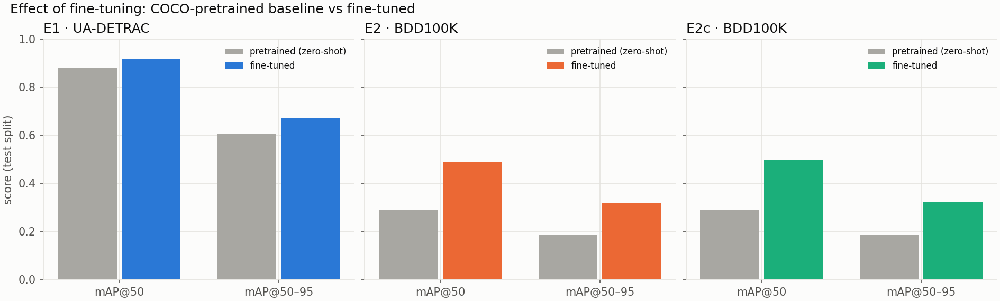
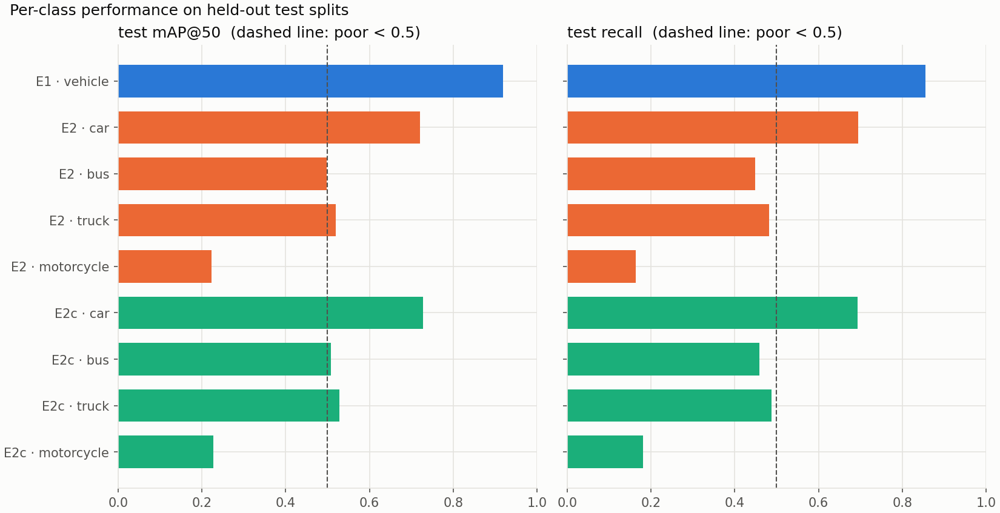

# SmartFlow — YOLOv8n vehicle detection: experiment comparison

_Generated 2026-10-23 04:26 UTC by notebook 03 from the saved run artefacts. No value in this report was entered by hand._

_Post-generation edit (wording only, **no value changed**): in Section 12, the experiment ids were added to two sentences, and the sentence on low-recall classes was corrected. Recall alone cannot show whether objects are missed or misclassified. Notebook 03 now generates this wording itself. Figure links point to `../02_figures/`._

## 1. Scope and claim boundaries

- **Model:** YOLOv8n, the vehicle-detection component of Raza et al., *IEEE Access* 13 (2025), doi:10.1109/ACCESS.2025.3602844.
- **Fine-tuning:** from COCO-pretrained weights with the paper's reported YOLOv8n training settings (AdamW, lr0 0.001, batch 16).
- **Not a reproduction of the paper.** The paper's Karachi dataset (8 South-Asian vehicle classes) is not public, and the paper does not report its mAP IoU threshold, input size or FPS protocol. The paper also compares YOLOv7-tiny, YOLOv8-s and YOLO-NAS-s, which were not run here.
- **Metric terminology:** mAP (mean average precision) is a **detection** metric that combines localisation (IoU) and ranking quality. It is not classification accuracy, and is reported as mAP@50 and mAP@50–95.

## 2. Experiments and status

| experiment | dataset | status | reason |
|---|---|---|---|
| E1 | UA-DETRAC | EVALUATED | — |
| E2 | BDD100K | EVALUATED | — |
| E2c | BDD100K | EVALUATED | — |
| E3 | QMUL Junction | SKIPPED | single 360x288 video with no bounding boxes; its ground-truth zip holds clip-level event labels + features (.mat) for unusual-event detection. Use only for inference-only demos; detection metrics would need new manual annotation. |
| E4 | AI City Challenge 2021 | SKIPPED | access via the official request form; T1 = movement counts, T2 = ReID crops, T4 = anomaly timestamps (none are detection boxes); T3 boxes are class-agnostic and cover only vehicles seen by >=2 cameras -> unsuitable for detector training. |

Experiments that were not evaluated have **no metric values**. Their reason is given above.

## 3. Comparison on held-out test splits

| Exp. | Dataset | Classes | Train img | Val img | Test img | Test inst. | P | R | F1 | mAP@50 | mAP@50–95 |
|---|---|---|---|---|---|---|---|---|---|---|---|
| E1 | UA-DETRAC | 1 | 6949 | 1443 | 5640 | 68401 | 0.957 | 0.856 | 0.904 | 0.918 | 0.670 |
| E2 | BDD100K | 4 | 20000 | 7000 | 10000 | 108797 | 0.616 | 0.447 | 0.518 | 0.491 | 0.318 |
| E2c | BDD100K | 4 | 20000 | 7000 | 10000 | 108797 | 0.598 | 0.456 | 0.517 | 0.498 | 0.325 |
| E3 | QMUL Junction | n/a | n/a | n/a | n/a | n/a | n/a | n/a | n/a | n/a | n/a |
| E4 | AI City Challenge 2021 | n/a | n/a | n/a | n/a | n/a | n/a | n/a | n/a | n/a | n/a |

| Exp. | Dataset version | Training data | Epochs done | Planned | Best epoch | Stop reason | Train time (h) | Checkpoint (MB) | Params | GFLOPs@640 |
|---|---|---|---|---|---|---|---|---|---|---|
| E1 | HF blues111/ua_detrac @ 206bb8fa86cd | full split | 50 | 50 | 50 | completed full epoch budget | 1.385 | 5.939 | 3011043 | 8.192 |
| E2 | BDD100K 100K images + labels_2018 detection labels | fixed subset of 20000 / 63000 (seed 42) | 27 | 50 | 27 | stopped by user (compute budget, finish_early) | 2.335 | 5.937 | 3011628 | 8.195 |
| E2c | BDD100K 100K images + labels_2018 detection labels | fixed subset of 20000 / 63000 (seed 42) | 50 | 50 | 38 | completed full epoch budget | 4.320 | 5.940 | 3011628 | 8.195 |
| E3 | n/a | n/a | n/a | n/a | n/a | n/a | n/a | n/a | n/a | n/a |
| E4 | n/a | n/a | n/a | n/a | n/a | n/a | n/a | n/a | n/a | n/a |

Full table: `metrics/final_comparison.csv` / `.xlsx`.

## 4. Pretrained baseline vs. fine-tuned

| Exp. | Dataset | Baseline mAP@50 | Baseline mAP@50–95 | Fine-tuned mAP@50 | Fine-tuned mAP@50–95 | Δ mAP@50 |
|---|---|---|---|---|---|---|
| E1 | UA-DETRAC | 0.879 | 0.606 | 0.918 | 0.670 | 0.039 |
| E2 | BDD100K | 0.289 | 0.185 | 0.491 | 0.318 | 0.202 |
| E2c | BDD100K | 0.289 | 0.185 | 0.498 | 0.325 | 0.209 |

**How the baseline was measured.** The baseline is the **same** COCO-pretrained `yolov8n.pt` used to initialise fine-tuning, evaluated zero-shot on the same test split with the same protocol. Its head was restricted to the mapped COCO classes:
- E1: COCO car, bus, truck → vehicle (merged into one class)
- E2: COCO car, bus, truck, motorcycle → car, bus, truck, motorcycle
- E2c: COCO car, bus, truck, motorcycle → car, bus, truck, motorcycle

Because COCO and each dataset define classes differently, part of the gap reflects **labelling conventions**, not only visual ability.

## 5. Per-class performance

A class is flagged **poor** if its test mAP@50 < 0.5 or its recall < 0.5.

| Exp. | Class | Train inst. | Test inst. | P | R | F1 | mAP@50 | mAP@50–95 | Poor |
|---|---|---|---|---|---|---|---|---|---|
| E1 | vehicle | 50417 | 68401 | 0.957 | 0.856 | 0.904 | 0.918 | 0.670 | False |
| E2 | car | 204295 | 102504 | 0.682 | 0.694 | 0.688 | 0.721 | 0.434 | False |
| E2 | bus | 3355 | 1597 | 0.568 | 0.449 | 0.501 | 0.498 | 0.378 | True |
| E2 | truck | 8537 | 4244 | 0.599 | 0.482 | 0.534 | 0.520 | 0.362 | True |
| E2 | motorcycle | 866 | 452 | 0.613 | 0.164 | 0.258 | 0.224 | 0.100 | True |
| E2c | car | 204295 | 102504 | 0.705 | 0.694 | 0.699 | 0.728 | 0.439 | False |
| E2c | bus | 3355 | 1597 | 0.582 | 0.459 | 0.513 | 0.508 | 0.386 | True |
| E2c | truck | 8537 | 4244 | 0.604 | 0.488 | 0.540 | 0.528 | 0.370 | True |
| E2c | motorcycle | 866 | 452 | 0.500 | 0.181 | 0.266 | 0.227 | 0.103 | True |

**Poor classes:** E2 `bus` (mAP@50 0.498, recall 0.449, 3355 training instances), E2 `truck` (mAP@50 0.520, recall 0.482, 8537 training instances), E2 `motorcycle` (mAP@50 0.224, recall 0.164, 866 training instances), E2c `bus` (mAP@50 0.508, recall 0.459, 3355 training instances), E2c `truck` (mAP@50 0.528, recall 0.488, 8537 training instances), E2c `motorcycle` (mAP@50 0.227, recall 0.181, 866 training instances).

## 6. Dataset differences

| Exp. | Dataset | Domain (documented) | Classes | Annotation (documented) | Preparation |
|---|---|---|---|---|---|
| E1 | UA-DETRAC | fixed, elevated traffic-surveillance cameras at urban roads in Beijing and Tianjin; video frames | 1 class: vehicle (car, bus, van, others merged; motorcycles/bicycles not annotated) | boxes from the original UA-DETRAC annotation (per-frame tracking annotation); the mirror keeps only 'vehicle' + 'ignored' regions (vehicle types car/bus/van/others are merged) | ignored regions masked grey; sequence-level splits; every 10th frame |
| E2 | BDD100K | dash-cam images from US cities, diverse weather and time of day (day/night) | 4 classes mapped from BDD categories: car, bus, truck (+trailer), motorcycle; pedestrian/rider/bicycle/traffic light/sign dropped; train and 'other vehicle' masked | official 2018 detection labels (the later 2020 revision with extra quality checks could not be downloaded) | test = official val; val = 10% of official train; one frame per video |
| E2c | BDD100K | dash-cam images from US cities, diverse weather and time of day (day/night) | 4 classes mapped from BDD categories: car, bus, truck (+trailer), motorcycle; pedestrian/rider/bicycle/traffic light/sign dropped; train and 'other vehicle' masked | official 2018 detection labels (the later 2020 revision with extra quality checks could not be downloaded) | test = official val; val = 10% of official train; one frame per video |

**Measured from the label files (splits as used):**

| Exp. | Split | Images | Resolution (top) | Inst./img | Median box area (px²) | Small % | Medium % | Large % |
|---|---|---|---|---|---|---|---|---|
| E1 | train | 6949 | 960x540 (6949) | 7.255 | 3862.597 | 13.248 | 61.533 | 25.220 |
| E1 | val | 1443 | 960x540 (1443) | 8.003 | 3292.089 | 14.782 | 67.224 | 17.994 |
| E1 | test | 5640 | 960x540 (5640) | 12.128 | 4012.484 | 7.035 | 67.253 | 25.712 |
| E2 | train | 20000 | 1280x720 (20000) | 10.853 | 1487.761 | 42.162 | 37.775 | 20.064 |
| E2 | val | 7000 | 1280x720 (7000) | 10.971 | 1458.756 | 42.380 | 38.028 | 19.593 |
| E2 | test | 10000 | 1280x720 (10000) | 10.880 | 1472.730 | 42.327 | 37.877 | 19.797 |
| E2c | train | 20000 | 1280x720 (20000) | 10.853 | 1487.761 | 42.162 | 37.775 | 20.064 |
| E2c | val | 7000 | 1280x720 (7000) | 10.971 | 1458.756 | 42.380 | 38.028 | 19.593 |
| E2c | test | 10000 | 1280x720 (10000) | 10.880 | 1472.730 | 42.327 | 37.877 | 19.797 |

## 7. Comparability

- **Different class definitions:** E1 has 1 class(es), E2 has 4 class(es), E2c has 4 class(es). A 1-class task is easier, so mAP across these rows is **not directly comparable**.
- **Different domains and annotation conventions:** UA-DETRAC: fixed, elevated traffic-surveillance cameras at urban roads in Beijing and Tianjin; video frames; BDD100K: dash-cam images from US cities, diverse weather and time of day (day/night); BDD100K: dash-cam images from US cities, diverse weather and time of day (day/night). Annotation processes and label versions differ (Section 6).
- **E2 trained 27 of 50 epochs** (stopped by user (compute budget, finish_early)). Its best epoch was 27, so it may be under-trained.
- **E2 used a fixed subset of 20000 of 63000 training images** (seed 42).
- **E2c used a fixed subset of 20000 of 63000 training images** (seed 42).
- **Original speed timings were taken on different devices** (E1: Tesla T4, E2: cpu, E2c: Tesla T4). Only the same-device re-measurement (Section 9) is comparable across experiments.
- **Same evaluation protocol for all fine-tuned rows:** Ultralytics `val()`, image size 640, conf 0.001, NMS IoU 0.7, COCO-style AP over 10 IoU thresholds. Its confidence for P/R/F1 is the one that maximises mean F1.
- **E1: validation mAP@50–95 (0.803) exceeds test (0.670) by 0.133.** The validation split is easier than or more similar to training than the test split.
- **Not comparable with the paper's 90% mAP / 74 FPS:** the dataset, classes, mAP definition and FPS protocol all differ or are unreported.

## 8. Held-out test verification

| Exp. | Evidence | Result |
|---|---|---|
| E1 | no overlap / duplicates across splits (nb01) | PASS |
| E1 | file lists equal the validated gate manifest (nb02) | PASS |
| E1 | training used the train-only YAML (no test key) | PASS |
| E1 | checkpoint selected on validation metric | PASS |
| E2 | no overlap / duplicates across splits (nb01) | PASS |
| E2 | file lists equal the validated gate manifest (nb02) | PASS |
| E2 | training subset (20000 imgs) inside train split | PASS |
| E2 | training used the train-only YAML (no test key) | PASS |
| E2 | checkpoint selected on validation metric | PASS |
| E2c | no overlap / duplicates across splits (nb01) | PASS |
| E2c | file lists equal the validated gate manifest (nb02) | PASS |
| E2c | training subset (20000 imgs) inside train split | PASS |
| E2c | training used the train-only YAML (no test key) | PASS |
| E2c | checkpoint selected on validation metric | PASS |

All reported test metrics were computed **once**, after training, on the held-out test split with the validation-selected `best.pt`. Nothing was selected or tuned on test data.

## 9. Efficiency

| Exp. | Latency (ms, same device) | FPS (same device) | Device | Latency (ms, original) | FPS (original) | Device (original) | Checkpoint (MB) |
|---|---|---|---|---|---|---|---|
| E1 | 5.270 | 189.768 | Tesla T4 | 4.909 | 203.720 | Tesla T4 | 5.939 |
| E2 | 4.148 | 241.100 | Tesla T4 | 179.737 | 5.564 | cpu | 5.937 |
| E2c | 4.183 | 239.057 | Tesla T4 | 4.473 | 223.551 | Tesla T4 | 5.940 |
| E3 | n/a | n/a | n/a | n/a | n/a | n/a | n/a |
| E4 | n/a | n/a | n/a | n/a | n/a | n/a | n/a |

**Method.** `predict()`, batch 1, FP32, image size 640, 10 warm-up images, then up to 200 timed test images. Latency is the mean of pre-processing, inference and post-processing time, and FPS = 1000 / latency. This is PyTorch on Colab hardware, **not** TensorRT or Jetson.

## 10. Reproducibility

- **Software:** Python 3.13.15, torch 2.11.0+cu130, ultralytics 8.4.160, numpy 2.1.3. Report generated with torch 2.11.0+cu130 on Tesla T4.
- **Model:** YOLOv8n (3,011,043 parameters), initialised from `yolov8n.pt` (sha256 `f59b3d833e2ff32e194b5bb8e08d211dc7c5bdf144b90d2c8412c47ccfc83b36`).
- **Training config (all experiments):** imgsz 640, epochs 50, batch 16, optimizer AdamW, lr0 0.001, patience 20, AMP True, deterministic True, close_mosaic 10, seed 42. Augmentation: Ultralytics defaults.
- **E1** (UA-DETRAC): data-gate fingerprint `18995ead5a60b480`; splits 6949/1443/5640; trained on 1 session(s), effective batch 16; checkpoint `/content/drive/MyDrive/SmartFlow/checkpoints/E1_ua_detrac_mirror_1cls__yolov8n_img640_e50_s42_e92689f0d0/weights/best.pt`.
- **E2** (BDD100K): data-gate fingerprint `d384be666065a1df`; splits 20000/7000/10000; training subset list `/content/drive/MyDrive/SmartFlow/reports/E2_bdd100k_4cls_train_subset_20000_s42.txt`; trained on 1 session(s), effective batch 16; checkpoint `/content/drive/MyDrive/SmartFlow/checkpoints/E2_bdd100k_4cls_train20000__yolov8n_img640_e50_s42_e92689f0d0/weights/best.pt`.
- **E2c** (BDD100K): data-gate fingerprint `d384be666065a1df`; splits 20000/7000/10000; training subset list `/content/drive/MyDrive/SmartFlow/reports/E2c_bdd100k_4cls_train_subset_20000_s42.txt`; trained on 1 session(s), effective batch 16; checkpoint `/content/drive/MyDrive/SmartFlow/checkpoints/E2c_bdd100k_4cls_train20000__yolov8n_img640_e50_s42_e92689f0d0/weights/best.pt`.
- **Split construction:** UA-DETRAC is split by sequence (frames sub-sampled after splitting). BDD100K uses the official val as test and a seeded 10% of official train as val. Leakage checks are in Section 8.
- **Artefacts:** `metrics/summary_all_experiments.csv`, `metrics/final_comparison.csv/.xlsx`, `metrics/final_per_class.csv`, per-run `report/metrics.json`, `reports/data_gate.json`.

## 11. Results reported by the paper (quoted, not reproduced)

Source: M. Raza et al., IEEE Access, vol. 13, pp. 153586-153613, 2025, doi:10.1109/ACCESS.2025.3602844. Dataset: private Karachi dataset (Allama Shabbir Usmani road), 8 classes, 1,373 source images; 2,726 after augmentation, 80/10/10 split (Table 4, Sec. III-A). Training: YOLOv8n: AdamW, lr 0.001, batch 16, 100 epochs (Table 7). The paper does not state the IoU threshold behind its mAP, and reports no precision, recall or F1.

| Model (Table 12) | Size (MB) | mAP % RGB | mAP % Gray | mAP % Green | FPS RGB (Tesla T4) |
|---|---|---|---|---|---|
| YOLOv7-tiny | 11.8 | 86.40 | 83.70 | 80.00 | 37.39 |
| YOLOv8-nano | 6.0 | 89.30 | 90.20 | 94.90 | 74.67 |
| YOLOv8-small | 21.5 | 90.50 | 91.00 | 95.00 | 69.59 |
| YOLO-NAS-small | 244.4 | 93.90 | 95.40 | 87.90 | 4.26 |

| Site (Table 15) | Model | mAP % | Jetson Nano FPS | Jetson Xavier FPS |
|---|---|---|---|---|
| Allama Shabbir Usmani | YOLOv7-tiny | 82 | 23 | 27 |
| Allama Shabbir Usmani | YOLOv8-nano | 83.7 | – | 35 |
| Teen Talwar | YOLOv7-tiny | 78.4 | 19 | 24 |
| Teen Talwar | YOLOv8-nano | 81.45 | – | 33.5 |

**YOLOv8n: this work next to the paper's reported values**

| Source | Dataset | Classes | Train images | Epochs | mAP | FPS (device) | Size (MB) | Directly comparable? |
|---|---|---|---|---|---|---|---|---|
| this work · E1 | UA-DETRAC | 1 | 6949 | 50/50 | mAP@50 0.918 / mAP@50-95 0.670 | 189.8 (Tesla T4, PyTorch FP32) | 5.9 | reference (our protocol) |
| this work · E2 | BDD100K | 4 | 20000 | 27/50 | mAP@50 0.491 / mAP@50-95 0.318 | 241.1 (Tesla T4, PyTorch FP32) | 5.9 | reference (our protocol) |
| this work · E2c | BDD100K | 4 | 20000 | 50/50 | mAP@50 0.498 / mAP@50-95 0.325 | 239.1 (Tesla T4, PyTorch FP32) | 5.9 | reference (our protocol) |
| paper · Table 12 (RGB) | private Karachi dataset | 8 | 2,182 (augmented) | 100 | mAP 89.30% (IoU threshold not stated) | 74.67 (Tesla T4, protocol not stated) | 6.0 | NO - different dataset/classes; mAP definition and FPS protocol unknown |
| paper · Table 15 (Allama Shabbir Usmani) | Allama Shabbir Usmani intersection (private) | 8 | 2,182 (augmented) | 100 | mAP 83.7% (IoU threshold not stated) | 35 (Jetson Xavier NX, TensorRT) | not reported | NO - different dataset/classes and device (edge, TensorRT) |
| paper · Table 15 (Teen Talwar) | Teen Talwar intersection (private) | 8 | 2,182 (augmented) | 100 | mAP 81.45% (IoU threshold not stated) | 33.5 (Jetson Xavier NX, TensorRT) | not reported | NO - different dataset/classes and device (edge, TensorRT) |

The checkpoint size matches the paper's YOLOv8n (about 6 MB), as expected for the same architecture. Accuracy and speed **cannot** be compared directly: the datasets, class sets, training length, mAP definition and timing hardware/protocol all differ. Note also that the paper's headline 74 FPS is its Tesla T4 figure (Table 12); on a Jetson Xavier NX it reports 33.5-35 FPS (Table 15).

## 12. Discussion

Fine-tuned YOLOv8n reached the highest test mAP@50–95 on **UA-DETRAC** (0.670; mAP@50 0.918). On **BDD100K** (E2, 27 epochs) it reached mAP@50–95 0.318 (mAP@50 0.491, recall 0.447). On **BDD100K** (E2c, 50 epochs) it reached mAP@50–95 0.325 (mAP@50 0.498, recall 0.456).

This ordering should **not** be read as one dataset being intrinsically easier than another. The experiments differ in number of classes, viewpoint, object size, training-set size and training length (Section 7). Each row measures the detector on its own task.

Compared with the COCO-pretrained baseline, fine-tuning changed test mAP@50 by: E1 +0.039, E2 +0.202, E2c +0.209. This includes adapting to each dataset's class definitions and viewpoint.

**Effect of training longer (E2 → E2c).** With identical data and settings, continuing from epoch 27 to 50 changed test mAP@50 from 0.491 to 0.498 (+0.007) and mAP@50–95 from 0.318 to 0.325 (+0.006). Recall changed from 0.447 to 0.456. This is a single run, so run-to-run variance is not measured.

Per class, the weakest results coincide with the rarest training classes (BDD100K `bus`: 3355, `truck`: 8537, `motorcycle`: 866 training instances; the same for E2 and E2c). Their recall is lower than their precision: many instances are not detected **as that class**. They are either missed entirely or assigned another class. The confusion matrices show which.

**Limitations.**
- Only YOLOv8n was evaluated, with one seed. Run-to-run variance is unmeasured, so small differences should not be over-interpreted.
- E2 trained 27 of 50 epochs (stopped by user (compute budget, finish_early)). Its best epoch was 27, so it may be under-trained.
- E2 used a fixed subset of 20000 of 63000 training images (seed 42).
- E2c used a fixed subset of 20000 of 63000 training images (seed 42).
- Datasets without detection boxes (see Section 2) could not be evaluated without manual annotation.

**Recommended next experiment.**
1. Re-train E2c on a GPU with the full training split (63000 images instead of the 20000-image subset), so that it matches the budget of the other experiments.
2. Address the poor classes with more training instances or class-balanced sampling, and report per-class results again.
3. Evaluate the paper's other detectors (YOLOv8-s, YOLOv7-tiny, YOLO-NAS-s) under the identical protocol, and time them with TensorRT on the target edge device, before comparing with the paper's 74 FPS.
